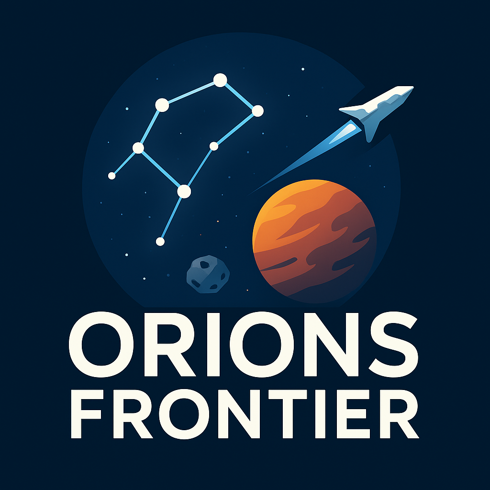

# Orion's Frontier

[](https://github.com/momoathome/orions-frontier/actions/workflows/ci.yml)

**Mein persönliches Space-Game-Projekt**

Seit vielen Jahren wollte ich ein eigenes Browsergame erschaffen – inspiriert von den großen
Klassikern, aber mit meiner eigenen Vision. Nach zahllosen Anläufen und verworfenen Versionen ist
daraus ein persistentes Idle-Browsergame entstanden: eine gemeinsame, lebende Galaxie voller
Raumstationen, Schiffe und endlicher Asteroiden.

Im Zentrum steht der Orion-Gürtel. Du triffst die wirtschaftlichen und strategischen
Entscheidungen, das Spiel führt sie aus – auch während du offline bist. Spieler und Bots erschließen
Asteroiden, schicken Miner auf sichtbare Rundläufe, gründen weitere Stationen und kämpfen um ihren
Platz im Herzen des Orion. Alle nutzen dieselben persistenten Reise-, Kosten- und Zeitregeln.

---

## Features

- **Live-Karte:** Eine persistente Sektorwelt mit Pixi-Darstellung. Miner, Flotten und Missionen
  sind als Rundläufe auf der Karte zu sehen und werden per WebSocket live aktualisiert.
- **Ressourcenabbau:** Endliche Asteroiden mit Carbon, Titanium, Hydrogenium und seltenen
  Ressourcen wie Kyber und Astatine. Mehrere Spieler können denselben Asteroiden leeren.
- **Raumstationen:** Gebäude, Lager und Bauplätze ausbauen. Die Lagerkapazität bestimmt, wie lange
  du ohne Verlust offline sein kannst.
- **Echte Bauschleifen:** Schiffe, Verteidigung und Forschung laufen in Warteschlangen, lassen sich
  abbrechen und werden nach Neustarts genau einmal abgeschlossen.
- **Forschung:** Account-weite Technologien in fünf Tiers. Sie verbessern Abbau, Antrieb, Scanner,
  Bau und Kampf und schalten Schiffe und Verteidigung frei.
- **Exploration und Kolonisation:** Scanner begrenzen die Sicht; neue Sektoren werden erkundet und
  mit weiteren Stationen besiedelt.
- **PvP und Vernichtung:** Stationen angreifen, Verteidigung brechen und mit Bombern die Integrität
  senken, bis die Station vernichtet ist. Neue Spieler sind 24 Stunden geschützt.
- **Bergung:** Nach Kämpfen bleiben Trümmerfelder zurück, die geplündert werden können.
- **Bots:** Wirtschaftliche und kriegerische Bots mit eigenen Profilen spielen nach denselben Regeln
  wie Spieler.
- **Einfluss und Ranking:** Dein Ausbau bestimmt deinen Einfluss und deinen Rang im Universum.
- **Logbuch:** Protokolliert Abbau, Bauaufträge, Forschung, Kämpfe und mehr.

## Roadmap

- [ ] **Balancing:** Kolonisationskosten, Bot-Ziele und Angriffsverhalten nach der Playtest-Baseline
      nachschärfen.
- [ ] **Logistik:** Ressourcen zwischen eigenen Stationen bewegen.
- [ ] **Radar:** Tarnung, Allianz-Radar und Radarlog.

## Tech Stack

- **Frontend:** Vue 3, Vue Router, Pixi.js, Tailwind CSS, Vite
- **Backend:** Node.js, Fastify, WebSocket (`ws`), Zod
- **Datenbank:** PostgreSQL mit Drizzle ORM
- **Sprache und Werkzeuge:** TypeScript, npm Workspaces, ESLint, Prettier, dependency-cruiser,
  Node Test Runner
- **Infrastruktur:** Docker Compose

## Architektur

Die API ist ein modularer Monolith. Die Fachlogik liegt in Service-Ordnern unter
`apps/api/src/services`, die in festen Schichten aufeinander aufbauen:

```text
auth, research, map, logbook, fleet
  → station → missions → world, mining, combat, ranking → transport → bot → simulation
```

Ein Ordner importiert nur Ordner tieferer Schichten und nur über deren `index.ts`; `lib` ist die
Basis und kennt keine Services. dependency-cruiser erzwingt diese Regeln bei jedem `npm run check`,
im Frontend ebenso die Grenzen zwischen den Feature-Ordnern unter `apps/frontend/src/features`.
Details: [services/README.md](apps/api/src/services/README.md).

### Invarianten

- PostgreSQL ist die einzige Quelle der Wahrheit; Zustandswechsel laufen atomar, auch unter
  Konkurrenz.
- Zeitgesteuerte Vorgänge überstehen Neustarts und werden höchstens einmal abgeschlossen.
- Bots nutzen dieselben Services, Kosten, Besitz- und Sichtregeln wie Spieler.
- Private und scannerbegrenzte Daten filtert der Server, nie der Client.
- Weltgenerierung und Regelberechnungen sind deterministisch.

### Sicherheit

Die Anmeldung nutzt ein JWT mit sieben Tagen Laufzeit im `localStorage`. Bewusst so gewählt: Rolle
und Kontostatus liest die API bei jeder Anfrage aus der Datenbank, das Token allein gewährt also
keine Rechte, die der Account nicht mehr hat. Das Frontend rendert kein `v-html`, und eine strikte
Content Security Policy (Build-Zeit im Frontend, `default-src 'none'` in der API) begrenzt die
Folgen einer XSS-Lücke.

## Getting Started

Voraussetzungen: Docker mit Docker Compose.

### Schritt 1: Repository klonen

```bash
git clone https://github.com/momoathome/orions-frontier.git
cd orions-frontier
```

### Schritt 2: Umgebungsvariablen anlegen

```bash
cp .env.example .env
```

### Schritt 3: Starten

```bash
npm run dev
```

Beim ersten Start werden Dependencies, Packages und Container gebaut. Die API führt ausstehende
Datenbankmigrationen selbstständig aus.

- Frontend: <http://localhost:5173>
- API: <http://localhost:3000/api>
- Healthcheck: <http://localhost:3000/api/health>
- WebSocket: `ws://localhost:3000`

Beenden:

```bash
docker compose down
```

Für einen vollständigen lokalen Reset:

```bash
docker compose down -v
```

## Workspace

```text
apps/
  api/           Fastify API, Simulation und PostgreSQL-Zugriff
  frontend/      Vue-Frontend und Pixi-Welt
packages/
  game-config/   Aktuelle Spieldefinitionen und Balancingwerte
  shared/        Gemeinsame Domain- und Transporttypen
```

`package.json` im Root ist der einzige Einstiegspunkt für Installation und übergreifende
Kommandos. Interne Pakete werden über npm Workspaces verknüpft.

## Lokale Werkzeuge

Voraussetzungen: Node.js 24.11 oder neuer und npm 10 oder neuer.

```bash
npm install
npm run check
npm run build
npm run test:unit
npm run test:integration
```

Häufige Kommandos:

```bash
npm run typecheck
npm run lint
npm run format
npm run db:migrate
npm run world:report
```

Die API führt Migrationen beim Start automatisch aus. `npm run db:migrate` ist nur für eine
manuelle Wiederholung nötig und lädt dabei die lokale `.env`-Datei.
`npm run world:report` erzeugt die konfigurierte Startwelt rein im Speicher und gibt Asteroidenzahl
sowie Ressourcenmenge je Sektor aus.

Migrationen liegen unter `apps/api/src/lib/db/migrations`, beginnend mit `0000_initial.sql`; die API
spielt fehlende beim Start ein.

`npm run test:unit` prüft die reine Spiellogik ohne externe Infrastruktur. Die Tests liegen unter
`apps/api/test/unit`. `npm run test:integration` startet eine eigene, flüchtige PostgreSQL-Instanz
(`compose.test.yaml`, die Dev-Welt bleibt unberührt) und prüft unter
`apps/api/test/integration` unter anderem API-Routen, konkurrierende Ressourcenausgaben und
Mining-Zugriffe, vollständige Mining-Rundläufe, Bots, Exploration, Kolonisation, Kampf, Bergung,
Forschung sowie WebSocket-Authentifizierung. Mit `npm run verify` laufen statische Checks, ein Audit der Laufzeit-Abhängigkeiten
(`npm run audit`), Build, beide Testgruppen und der Playtest-E2E (`npm run test:playtest-e2e`)
gemeinsam.

Einzelne Workspaces lassen sich direkt ansprechen:

```bash
npm run dev --workspace @orions-frontier/frontend
npm run dev --workspace @orions-frontier/api
```

Die API benötigt dabei die Werte aus `.env` sowie laufendes PostgreSQL. Für die normale
Entwicklung ist deshalb Docker Compose der vorgesehene Einstieg. WebSocket und Simulation laufen
direkt im API-Prozess; fällige Vorgänge werden aus PostgreSQL nachgeholt.

## Teststrategie

- **Unit (API):** reine Spiellogik ohne Infrastruktur, `apps/api/test/unit`, Node Test Runner.
- **Integration (API):** gegen eine echte, flüchtige PostgreSQL-Instanz; prüft Routen, Konkurrenz,
  Besitz, Sichtbarkeit und zeitgesteuerte Abschlüsse.
- **Playtest:** beschleunigte Simulation ganzer Welten mit Bots, bricht bei Invariantenverletzungen
  ab (siehe unten).
- **Unit (Frontend):** Vitest für Stores und Hilfslogik, `apps/frontend/test/unit`.
- **E2E (Frontend):** Playwright-Smoke-Test über Registrierung, Stationsgründung und Karte.
  Braucht den laufenden Dev-Stack (`npm run dev`) und legt dort Test-Accounts an:

  ```bash
  npm run test:e2e
  ```

GitHub Actions führt bei jedem Push und Pull Request Checks, Audit, Unit-Tests, Build und die
Integrationstests aus.

## KI-gestützte Entwicklung

Das Projekt entsteht weitgehend mit KI-Agenten (Claude Code, Codex). Damit das tragfähig bleibt,
sind die Leitplanken maschinell geprüft statt nur dokumentiert:

- [AGENTS.md](AGENTS.md) hält Produktziel, Invarianten und Arbeitsregeln für Agenten fest.
- Ein Pre-commit-Hook führt `npm run check` aus: Typecheck, strenges ESLint (u. a. keine
  `as`-Casts, keine Modul-Mocks), Modulgrenzen und Prettier.
- `npm run verify` ist das Gate für neue oder geänderte Mechaniken: alle Checks, beide
  Testgruppen und der Playtest-E2E.
- Bewusst akzeptierte Grenzen stehen als `known-limit:`-Kommentar direkt im Code.

## Beschleunigter Spieltest

Der Playtest läuft ohne HTTP-Server und ohne Echtzeitwarten gegen eine eigene, wegwerfbare
PostgreSQL-Instanz. Er akzeptiert weder die Entwicklungs- noch die normale Testdatenbank.

```bash
npm run playtest -- \
  --seed lokaler-versuch \
  --duration-hours 24 \
  --step-seconds 60 \
  --join-interval-minutes 15 \
  --population-limit 12 \
  --snapshot-interval-minutes 15
```

Ohne Flags gelten genau diese Werte sowie der virtuelle Start
`2030-01-01T00:00:00.000Z`. Mit `--config <datei.json>` kann eine Konfiguration geladen werden;
einzelne CLI-Flags überschreiben die Datei. Profilgewichte lassen sich beispielsweise über
`--profile-technocrat 4` und die entsprechenden Flags für `industrialist`, `pioneer` und `warlord`
setzen.

Der versionierte JSON-Bericht landet standardmäßig unter `artifacts/playtests/`. Harte
Invariantenverletzungen beenden den Lauf mit Fehlerstatus und erzeugen einen gültigen Teilbericht.
Softlock- und Balancehinweise sind dagegen Warnungen: Sie erscheinen mit Belegen im Bericht,
verändern den Exit-Code in Version 1 aber nicht.

Kurze technische Prüfungen:

```bash
npm run test:playtest-e2e
```

Reproduzierbare Presets liegen unter `configs/playtest/`. Die technische Entwicklungsbaseline
über drei frische Welten läuft je 72 virtuelle Stunden, damit Kolonisation und Angriffe nach dem
24-Stunden-Schutz mitgemessen werden:

```bash
npm run playtest:baseline
```

## Entwicklungsprinzip

Wir erweitern den vorhandenen technischen Vorsprung nicht um weitere klassische
Browsergame-Kataloge. Neue Arbeit stärkt den spielergesteuerten Idle-Kern: endliche Asteroiden,
sichtbare Mining-Rundläufe, verständliche Leistungswerte und bewusste Investitionsentscheidungen.

Richtung, Entscheidungen, Zahlenziele und offene Arbeit stehen im
[Design-Kompass](docs/design-compass.md). Die fachlichen Verträge der Systeme:

- [Mining-Rundlauf](docs/mining-loop.md)
- [Stationskapazitäten](docs/station-capacities.md)
- [Weltgenerierung](docs/world-generation.md)
- [Scanner und Sichtbarkeit](docs/scanner-visibility.md)
- [Bot-System](docs/bot-system.md)

Offene Specs für die nächste Mechanik: [Bomber und Vernichtung](docs/station-destruction.md).

Abgeschlossene Pläne und Tickets stehen in der Git-Historie, nicht in `docs/`.

## Lizenz

Copyright © 2024–2026 Maurice Knoll. Alle Rechte vorbehalten.

Orion's Frontier ist ein persönliches Herzensprojekt und **keine Open-Source-Software**. Der
Quellcode, die Grafiken und alle übrigen Inhalte dürfen ausschließlich angesehen und zu privaten
Lernzwecken lokal ausgeführt werden. Veröffentlichung, Weiterverbreitung, das Betreiben eigener
Server, das Re-Releasen, kommerzielle Nutzung und die Verwendung zum Training von KI-Modellen sind
ohne vorherige schriftliche Zustimmung ausdrücklich untersagt. Verbindlich ist der vollständige Text
in [LICENSE](LICENSE).

## Feedback

Feedback gerne über [GitHub Issues](https://github.com/momoathome/orions-frontier/issues).

**Viel Spaß beim Erkunden des Universums!**

- [@momoathome](https://github.com/momoathome) - Maurice
